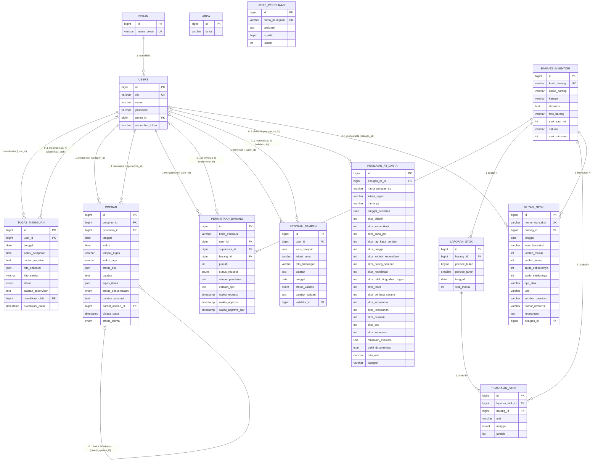

# ERD, Transform ERD ke LRS, dan LRS
## SIM Kebersihan — Puskesmas Kecamatan Cempaka Putih

**Dibuat berdasarkan:** Schema database aktual (SHOW FULL COLUMNS + INFORMATION_SCHEMA)  
**Tanggal:** September 2026 | **Total Tabel Aktif:** 14 tabel

---

## 1. ERD (Entity Relationship Diagram)

### 1.1 Diagram ERD



---

### 1.2 Tabel Kardinalitas Relasi

| Entitas Asal | Relasi | Entitas Tujuan | Kolom FK | Keterangan |
|---|---|---|---|---|
| `peran` | 1 — N | `users` | `users.peran_id` | Satu peran dimiliki banyak pengguna |
| `users` | 1 — N | `tugas_mingguan` | `tugas_mingguan.user_id` | Satu CS membuat banyak tugas |
| `users` | 0..1 — N | `tugas_mingguan` | `tugas_mingguan.diverifikasi_oleh` | Satu supervisor memverifikasi banyak tugas |
| `users` | 1 — N | `operan` | `operan.pengirim_id` | Satu user mengirim banyak operan |
| `users` | 1 — N | `operan` | `operan.penerima_id` | Satu user menerima banyak operan |
| `operan` | 0..1 — N | `operan` *(self)* | `operan.parent_operan_id` | Satu operan jadi induk banyak eskalasi |
| `users` | 1 — N | `permintaan_barang` | `permintaan_barang.user_id` | Satu CS mengajukan banyak permintaan |
| `users` | 0..1 — N | `permintaan_barang` | `permintaan_barang.supervisor_id` | Satu supervisor menyetujui banyak permintaan |
| `barang_inventori` | 1 — N | `permintaan_barang` | `permintaan_barang.barang_id` | Satu barang diminta berkali-kali |
| `barang_inventori` | 1 — N | `laporan_stok` | `laporan_stok.barang_id` | Satu barang dicatat di banyak periode |
| `laporan_stok` | 1 — N | `pemakaian_stok` | `pemakaian_stok.laporan_stok_id` | Satu laporan punya banyak rincian pemakaian |
| `barang_inventori` | 1 — N | `pemakaian_stok` | `pemakaian_stok.barang_id` | Satu barang punya banyak catatan pemakaian |
| `barang_inventori` | 1 — N | `mutasi_stok` | `mutasi_stok.barang_id` | Satu barang punya banyak mutasi |
| `users` | 0..1 — N | `mutasi_stok` | `mutasi_stok.petugas_id` | Satu petugas mencatat banyak mutasi |
| `users` | 1 — N | `setoran_sampah` | `setoran_sampah.user_id` | Satu CS menyetor banyak kali |
| `users` | 0..1 — N | `setoran_sampah` | `setoran_sampah.validator_id` | Satu supervisor memvalidasi banyak setoran |
| `users` | 0..1 — N | `penilaian_pj_lantai` | `penilaian_pj_lantai.petugas_cs_id` | Satu CS dinilai berkali-kali |

---

## 2. Transform ERD ke LRS

Proses transformasi mengikuti 3 aturan standar:

### Aturan Transformasi

**Aturan 1 — Entitas kuat → Tabel sendiri**  
Setiap entitas diubah menjadi tabel. Primary key entitas menjadi primary key tabel.

**Aturan 2 — Relasi 1:N**  
Foreign key ditempatkan di sisi **N** (banyak), menunjuk ke primary key sisi **1** (satu).

**Aturan 3 — Relasi N:M**  
Dibuat tabel junction baru dengan dua foreign key dari kedua entitas yang berelasi.  
*(Tidak ada relasi N:M di database ini — sudah didenormalisasi dengan benar)*

**Aturan 4 — Relasi Unary (Self-referential)**  
Foreign key opsional (`NULL`) dalam tabel yang sama.  
Contoh: `operan.parent_operan_id → operan.id`

---

### Hasil Transformasi

| Entitas / Relasi | Aturan | Hasil |
|---|---|---|
| `peran` | Entitas kuat | Tabel `peran` |
| `users` | Entitas kuat | Tabel `users` |
| `peran` 1:N `users` | Relasi 1:N | FK `peran_id` di `users` |
| `area` | Entitas kuat, standalone | Tabel `area` |
| `jenis_pekerjaan` | Entitas kuat, standalone | Tabel `jenis_pekerjaan` |
| `tugas_mingguan` | Entitas kuat | Tabel `tugas_mingguan` |
| `users` 1:N `tugas_mingguan` (buat) | Relasi 1:N | FK `user_id` di `tugas_mingguan` |
| `users` 1:N `tugas_mingguan` (verif) | Relasi 1:N optional | FK `diverifikasi_oleh` di `tugas_mingguan` (NULL) |
| `operan` | Entitas kuat | Tabel `operan` |
| `users` 1:N `operan` (kirim) | Relasi 1:N | FK `pengirim_id` di `operan` |
| `users` 1:N `operan` (terima) | Relasi 1:N | FK `penerima_id` di `operan` |
| `operan` 0..1:N `operan` (eskalasi) | Relasi Unary | FK `parent_operan_id` di `operan` (NULL) |
| `barang_inventori` | Entitas kuat | Tabel `barang_inventori` |
| `permintaan_barang` | Entitas kuat | Tabel `permintaan_barang` |
| `users` 1:N `permintaan_barang` (CS) | Relasi 1:N | FK `user_id` di `permintaan_barang` |
| `users` 0..1:N `permintaan_barang` (spv) | Relasi 1:N optional | FK `supervisor_id` di `permintaan_barang` (NULL) |
| `barang` 1:N `permintaan_barang` | Relasi 1:N | FK `barang_id` di `permintaan_barang` |
| `laporan_stok` | Entitas kuat | Tabel `laporan_stok` |
| `barang` 1:N `laporan_stok` | Relasi 1:N | FK `barang_id` di `laporan_stok` |
| `pemakaian_stok` | Entitas asosiatif (detail laporan) | Tabel `pemakaian_stok` |
| `laporan_stok` 1:N `pemakaian_stok` | Relasi 1:N | FK `laporan_stok_id` di `pemakaian_stok` |
| `barang` 1:N `pemakaian_stok` | Relasi 1:N | FK `barang_id` di `pemakaian_stok` |
| `mutasi_stok` | Entitas kuat (audit trail) | Tabel `mutasi_stok` |
| `barang` 1:N `mutasi_stok` | Relasi 1:N | FK `barang_id` di `mutasi_stok` |
| `users` 0..1:N `mutasi_stok` | Relasi 1:N optional | FK `petugas_id` di `mutasi_stok` (NULL) |
| `setoran_sampah` | Entitas kuat | Tabel `setoran_sampah` |
| `users` 1:N `setoran_sampah` (setor) | Relasi 1:N | FK `user_id` di `setoran_sampah` |
| `users` 0..1:N `setoran_sampah` (valid) | Relasi 1:N optional | FK `validator_id` di `setoran_sampah` (NULL) |
| `penilaian_pj_lantai` | Entitas kuat | Tabel `penilaian_pj_lantai` |
| `users` 0..1:N `penilaian_pj_lantai` | Relasi 1:N optional | FK `petugas_cs_id` di `penilaian_pj_lantai` (NULL) |

---

## 3. LRS (Logical Record Structure)

Notasi:
- **PK** = Primary Key (garis bawah tunggal)
- **FK** = Foreign Key (garis bawah putus-putus)
- **UK** = Unique Key
- `*` = Wajib diisi (NOT NULL)
- `°` = Boleh kosong (NULL)

---

### 3.1 peran

```
peran
┌─────────────────────────────────────────────────┐
│ PK  id              bigint          NOT NULL     │
│ UK  nama_peran      varchar(255)    NOT NULL      │
│     created_at      timestamp       NULL          │
│     updated_at      timestamp       NULL          │
└─────────────────────────────────────────────────┘

Nilai: admin | supervisor | pj_lantai | cs | gudang
```

---

### 3.2 users

```
users
┌─────────────────────────────────────────────────┐
│ PK  id              bigint          NOT NULL     │
│ UK  nik             varchar(20)     NOT NULL      │
│ *   name            varchar(255)    NOT NULL      │
│ *   password        varchar(255)    NOT NULL      │
│ FK° peran_id        bigint          NULL          │──→ peran(id)
│ °   remember_token  varchar(100)    NULL          │
│     created_at      timestamp       NULL          │
│     updated_at      timestamp       NULL          │
└─────────────────────────────────────────────────┘
```

---

### 3.3 area

```
area
┌─────────────────────────────────────────────────┐
│ PK  id              bigint          NOT NULL     │
│ *   lantai          varchar(20)     NOT NULL      │
│     created_at      timestamp       NULL          │
│     updated_at      timestamp       NULL          │
└─────────────────────────────────────────────────┘

Contoh nilai: Lantai 1, Lantai 2, ..., Rawasari, CPB, CPT, CSSD
```

---

### 3.4 jenis_pekerjaan

```
jenis_pekerjaan
┌─────────────────────────────────────────────────┐
│ PK  id              bigint          NOT NULL     │
│ UK  nama_pekerjaan  varchar(150)    NOT NULL      │
│ °   deskripsi       text            NULL          │
│ *   is_aktif        tinyint(1)      NOT NULL  =1  │
│ *   urutan          int             NOT NULL  =0  │
│     created_at      timestamp       NULL          │
│     updated_at      timestamp       NULL          │
└─────────────────────────────────────────────────┘
```

---

### 3.5 tugas_mingguan

```
tugas_mingguan
┌─────────────────────────────────────────────────┐
│ PK  id                  bigint      NOT NULL     │
│ FK* user_id             bigint      NOT NULL     │──→ users(id)
│ *   tanggal             date        NOT NULL      │
│ *   waktu_pelaporan     time        NOT NULL      │
│ *   rincian_kegiatan    text        NOT NULL      │
│ °   foto_sebelum        json        NULL          │ (array paths)
│ °   foto_setelah        varchar(255)NULL          │
│ *   status              enum        NOT NULL  =proses│
│     ('proses','selesai','disetujui')              │
│ °   catatan_supervisor  text        NULL          │
│ FK° diverifikasi_oleh   bigint      NULL          │──→ users(id)
│ °   diverifikasi_pada   timestamp   NULL          │
│     created_at          timestamp   NULL          │
│     updated_at          timestamp   NULL          │
└─────────────────────────────────────────────────┘
```

---

### 3.6 operan

```
operan
┌─────────────────────────────────────────────────┐
│ PK  id                  bigint      NOT NULL     │
│ FK* pengirim_id         bigint      NOT NULL     │──→ users(id)
│ FK* penerima_id         bigint      NOT NULL     │──→ users(id)
│ *   tanggal             date        NOT NULL      │
│ *   waktu               time        NOT NULL      │
│ °   tempat_tugas        varchar(255)NULL          │
│ °   waktu_jaga          varchar(255)NULL          │
│ °   status_alat         json        NULL          │
│ °   catatan             text        NULL          │
│ °   tugas_items         json        NULL          │
│ *   status_penyelesaian enum        NOT NULL  =belum│
│     ('belum','selesai','dieskalasi')              │
│ °   catatan_eskalasi    text        NULL          │
│ FK° parent_operan_id    bigint      NULL          │──→ operan(id) ← Self-ref
│ °   dibaca_pada         timestamp   NULL          │
│ *   status_terima       enum        NOT NULL  =menunggu│
│     ('menunggu','diterima')                       │
│     created_at          timestamp   NULL          │
│     updated_at          timestamp   NULL          │
└─────────────────────────────────────────────────┘
```

---

### 3.7 barang_inventori

```
barang_inventori
┌─────────────────────────────────────────────────┐
│ PK  id              bigint          NOT NULL     │
│ UK° kode_barang     varchar(30)     NULL          │ (format: BRG-0001)
│ *   nama_barang     varchar(255)    NOT NULL      │
│ °   kategori        varchar(50)     NULL      =Pembersih & Sanitasi│
│ °   deskripsi       text            NULL          │
│ °   foto_barang     varchar(255)    NULL          │
│ *   stok_saat_ini   int unsigned    NOT NULL  =0  │
│ *   satuan          varchar(255)    NOT NULL  =pcs│
│ *   stok_minimum    int unsigned    NOT NULL  =5  │
│     created_at      timestamp       NULL          │
│     updated_at      timestamp       NULL          │
└─────────────────────────────────────────────────┘

Kategori: Pembersih & Sanitasi | Peralatan Kebersihan |
          Perlengkapan Keselamatan | Kantong & Kemasan |
          Pewangi & Deodorant | Lainnya
```

---

### 3.8 permintaan_barang

```
permintaan_barang
┌─────────────────────────────────────────────────┐
│ PK  id                  bigint      NOT NULL     │
│ IX° kode_transaksi      varchar(40) NULL          │ (format: BT-2610-001)
│ FK* user_id             bigint      NOT NULL     │──→ users(id)
│ FK° supervisor_id       bigint      NULL          │──→ users(id)
│ FK* barang_id           bigint      NOT NULL     │──→ barang_inventori(id)
│ *   jumlah              int unsigned NOT NULL    │
│ *   status_request      enum        NOT NULL  =menunggu_spv│
│     ('menunggu_spv','disetujui_spv',              │
│      'ditolak_spv','disetujui','ditolak')         │
│ °   alasan_penolakan    text        NULL          │
│ °   catatan_spv         text        NULL          │
│ *   waktu_request       timestamp   NOT NULL  =CURRENT_TIMESTAMP│
│ °   waktu_approve       timestamp   NULL          │
│ °   waktu_approve_spv   timestamp   NULL          │
│     created_at          timestamp   NULL          │
│     updated_at          timestamp   NULL          │
└─────────────────────────────────────────────────┘

Alur status: menunggu_spv → disetujui_spv → disetujui
                          └→ ditolak_spv
                                         └→ ditolak
```

---

### 3.9 laporan_stok

```
laporan_stok
┌─────────────────────────────────────────────────┐
│ PK  id              bigint          NOT NULL     │
│ FK° barang_id       bigint          NULL          │──→ barang_inventori(id)
│ *   periode_bulan   tinyint unsigned NOT NULL    │ (1–12)
│ *   periode_tahun   smallint unsigned NOT NULL   │ (mis. 2026)
│ °   tanggal         date            NULL          │
│ *   stok_masuk      int unsigned    NOT NULL  =0  │
│     created_at      timestamp       NULL          │
│     updated_at      timestamp       NULL          │
└─────────────────────────────────────────────────┘

Constraint: (barang_id, periode_bulan, periode_tahun) UNIQUE
```

---

### 3.10 pemakaian_stok

```
pemakaian_stok
┌─────────────────────────────────────────────────┐
│ PK  id              bigint          NOT NULL     │
│ FK* laporan_stok_id bigint          NOT NULL     │──→ laporan_stok(id)
│ FK° barang_id       bigint          NULL          │──→ barang_inventori(id)
│ *   unit            varchar(30)     NOT NULL      │
│ *   minggu          tinyint unsigned NOT NULL    │ (1–4)
│ *   jumlah          int unsigned    NOT NULL  =0  │
│     created_at      timestamp       NULL          │
│     updated_at      timestamp       NULL          │
└─────────────────────────────────────────────────┘

Constraint: (laporan_stok_id, unit, minggu) UNIQUE
Unit: Lantai 1–6, Rawasari, CPB, CPT, CSSD
```

---

### 3.11 mutasi_stok

```
mutasi_stok
┌─────────────────────────────────────────────────┐
│ PK  id                  bigint      NOT NULL     │
│ UK  nomor_transaksi     varchar(50) NOT NULL      │
│ FK* barang_id           bigint      NOT NULL     │──→ barang_inventori(id)
│ *   tanggal             date        NOT NULL      │
│ *   jenis_transaksi     varchar(30) NOT NULL   IX │
│ *   jumlah_masuk        int unsigned NOT NULL =0  │
│ *   jumlah_keluar       int unsigned NOT NULL =0  │
│ *   saldo_sebelumnya    int         NOT NULL  =0  │
│ *   saldo_setelahnya    int         NOT NULL  =0  │
│ *   tipe_stok           varchar(20) NOT NULL  =gudang│
│ °   unit                varchar(100)NULL          │
│ °   sumber_pasokan      varchar(150)NULL          │
│ °   nomor_referensi     varchar(100)NULL          │
│ °   keterangan          text        NULL          │
│ FK° petugas_id          bigint      NULL          │──→ users(id)
│     created_at          timestamp   NULL          │
│     updated_at          timestamp   NULL          │
└─────────────────────────────────────────────────┘

jenis_transaksi: stok_masuk | permintaan_disetujui |
                 penyesuaian_tambah | penyesuaian_kurang | dll
```

---

### 3.12 setoran_sampah

```
setoran_sampah
┌─────────────────────────────────────────────────┐
│ PK  id                  bigint      NOT NULL     │
│ FK* user_id             bigint      NOT NULL     │──→ users(id)
│ *   jenis_sampah        json        NOT NULL      │ (array string)
│ °   lokasi_setor        varchar(255)NULL          │
│ °   foto_timbangan      varchar(255)NULL          │
│ °   catatan             text        NULL          │
│ *   tanggal             date        NOT NULL      │
│ *   status_validasi     enum        NOT NULL  =menunggu│
│     ('menunggu','valid','ditolak')                │
│ °   catatan_validasi    text        NULL          │
│ FK° validator_id        bigint      NULL          │──→ users(id)
│     created_at          timestamp   NULL          │
│     updated_at          timestamp   NULL          │
└─────────────────────────────────────────────────┘

jenis_sampah: Botol Plastik | Kardus | Derigen |
              Kertas | Duplex | Kaleng | Koran | Lainnya
```

---

### 3.13 penilaian_pj_lantai

```
penilaian_pj_lantai
┌─────────────────────────────────────────────────────────────┐
│ PK  id                          bigint      NOT NULL        │
│ FK° petugas_cs_id               bigint      NULL            │──→ users(id)
│ *   nama_petugas_cs             varchar(255)NOT NULL        │
│ *   lokasi_tugas                varchar(255)NOT NULL        │
│ *   nama_pj                     varchar(255)NOT NULL        │
│ *   tanggal_penilaian           date        NOT NULL        │
│                                                             │
│ ── Grup A: Kehadiran/Absensi ──────────────────────────── │
│ *   skor_disiplin               int         NOT NULL        │
│ *   skor_komunikasi             int         NOT NULL        │
│                                                             │
│ ── Grup B: Kinerja/Pelayanan (12 indikator) ────────────── │
│ *   skor_sapu_pel               int         NOT NULL        │
│ *   skor_lap_kaca_perabot       int         NOT NULL        │
│ *   skor_tangga                 int         NOT NULL        │
│ *   skor_kontrol_kebersihan     int         NOT NULL        │
│ *   skor_buang_sampah           int         NOT NULL        │
│ *   skor_koordinasi             int         NOT NULL        │
│ *   skor_tidak_tinggalkan_tugas int         NOT NULL        │
│ *   skor_toilet                 int         NOT NULL        │
│ *   skor_pelihara_sarana        int         NOT NULL        │
│ *   skor_kerjasama              int         NOT NULL        │
│ *   skor_kesopanan              int         NOT NULL        │
│ *   skor_cekatan                int         NOT NULL        │
│                                                             │
│ ── Grup C: Mutu Pelayanan ─────────────────────────────── │
│ *   skor_sop                    int         NOT NULL        │
│ *   skor_kepuasan               int         NOT NULL        │
│                                                             │
│ *   masukan_evaluasi            text        NOT NULL        │
│ °   bukti_dokumentasi           json        NULL            │
│ *   rata_rata                   decimal(5,2)NOT NULL        │
│ *   kategori                    varchar(50) NOT NULL        │
│     created_at                  timestamp   NULL            │
│     updated_at                  timestamp   NULL            │
└─────────────────────────────────────────────────────────────┘

kategori: Sangat Baik (≥86) | Baik (76–85) | Cukup (75) |
          Kurang (51–74) | Sangat Kurang (≤50)
```

---

## 4. Peta Relasi Antar Tabel (Ringkasan)

```
peran ──────────────────────────────────────────────── 1:N ─── users
                                                                 │
                    ┌────────────────────────────────────────────┤
                    │            │             │          │       │
                   1:N          1:N           1:N        1:N    1:N
                    │            │             │          │       │
            tugas_mingguan    operan    permintaan_    setoran_ penilaian_
               (user_id)   (pengirim_id  barang        sampah   pj_lantai
                           penerima_id)  (user_id     (user_id  (petugas_
                           [self-ref]    superv_id)   valid_id)  cs_id)
                                              │
                                             1:N
                                              │
                                       barang_inventori
                                        │    │     │
                                       1:N  1:N   1:N
                                        │    │     │
                                 laporan_ pemakaian_ mutasi_
                                   stok     stok      stok
                                    │        │
                                   1:N      │
                                    └───────┘
                                  (laporan_stok_id)
```

---

## 5. Tabel Sistem (Tidak Termasuk ERD Bisnis)

| Tabel | Fungsi |
|---|---|
| `failed_jobs` | Antrian job yang gagal (Laravel Queue) |
| `migrations` | Tracking versi migrasi database (Laravel) |
| `password_reset_tokens` | Token untuk reset password (Laravel Auth) |
